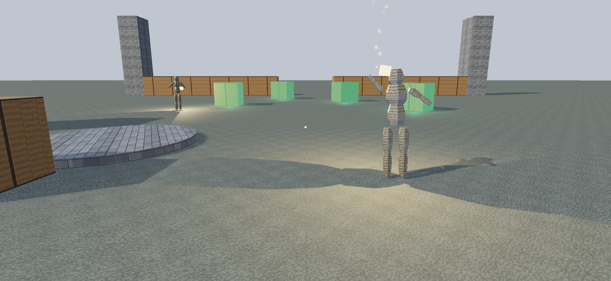

# Writing a docs page

Pages are `docs-src/<slug>.md`, built into `docs/<slug>.html` by `../build-docs.py` (run it; never edit `docs/*.html`).

## Format

```
---
title: Shadows
description: One sentence for search engines and the search box.
---
The first paragraph is the page's lead: what this is and when you need it, in two or three sentences.

## A section {#optional-id}
Paragraphs. `code`, **bold**, *emphasis*, [links](other-page.html).

### A subsection

- lists
1. numbered lists

```swift
// code, real API only
```

```sh
swift test
```

| Column | Column |
| --- | --- |
| cell | cell |

> A note: one paragraph that matters more than the text around it.


```

`{{version}}` is replaced with the engine's version. Images available: `../images/courtyard.jpg`,
`courtyard-turntable.jpg`, `ruins-from-above.jpg`, `ruins-lintel.jpg` (the sample, running).

## Rules

- **Real API only, as it is at the current version.** Every type, method, property and label must exist in
  `Sources/WindageEngine` exactly as written. Read the source; copy signatures. If unsure, leave it out.
- **Examples come from the sample** (`Sources/WindageSample`, `Sources/WindageSampleCore`) wherever it uses the
  feature — trimmed, never invented. A game's code outside the engine is shown as "your game".
- **Facts come from the engine's `README.md`, its doc comments and its tests** — including what a feature
  deliberately does not do. Never claim a feature the engine lacks.
- **Name no product or game.** Not the studio's titles, not apps built on the engine. Say "a game".
- **US English** in prose: color, center, meter, gray, behavior, license.
- **Plain and direct**, 400–900 words: what it is, how to use it, the decisions a reader needs, the gotchas.
  Link related pages by slug: start, sample, first-game, game-loop, fixed-timestep, running-hidden, camera,
  meshes, materials, shadows, lights, sky, tone-mapping, particles, instancing, level-of-detail, culling, hud,
  skeletons, character-controller, attachments, levels, audio, input, saving, splash, mark, walks, frames,
  reference, changelog.
