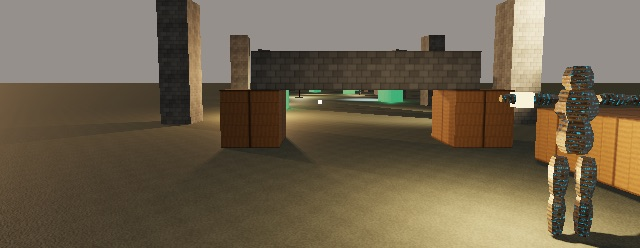

Windage Engine is a Swift package. Add it, run the sample game that ships with it, then play that game by script and check it the way the engine checks itself.

    
macOS 26+Swift 6.2Metal 4 GPU

    <ol class="steps">
      <li>
        <h2 id="add">Add the package</h2>
        
In your game's <code>Package.swift</code>:

<pre>dependencies: [
    .package(url: "https://…/WindageEngine.git", from: "{{version}}")
]</pre>
      </li>
      <li>
        <h2 id="run">Run the sample</h2>
        
A complete small game — two levels, an editor, sound, a save — written against the public API only. It opens with the engine's splash; any key skips it and still does what it was pressed for.

<pre>swift run WindageSample</pre>
        <figure><figcaption>The ruins at eye height, drawn by the sample.</figcaption></figure>
      </li>
      <li>
        <h2 id="script">Play it by script</h2>
        
Keys and seconds, pressed through the same path a keyboard uses. The log says where the feet ended each segment.

<pre>WINDAGE_SAMPLE_LEVEL=1 \
WINDAGE_SAMPLE_WALK="d:0.7 w:1.0 w:0.4 wait:1" swift run WindageSample
WindageSample: walk 'w:1.0' → feet (4.20, 1.20, -0.00), highest 1.20, on the ground, eye 1.69 m up</pre>
      </li>
      <li>
        <h2 id="check">Check it</h2>
        
Tests, every recorded walk, and every recorded frame — the three checks the engine runs on itself before a change is called done.

<pre>swift test
python3 Tools/walks.py
python3 Tools/frames.py</pre>
      </li>
    </ol>
